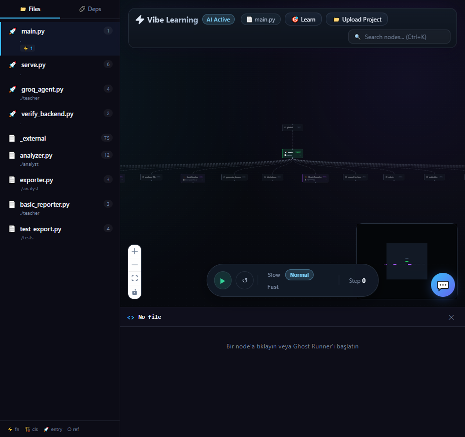
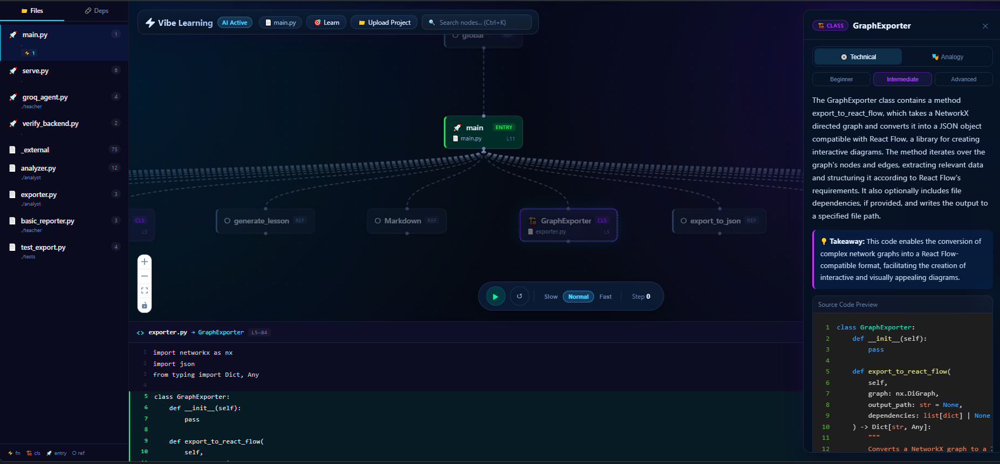
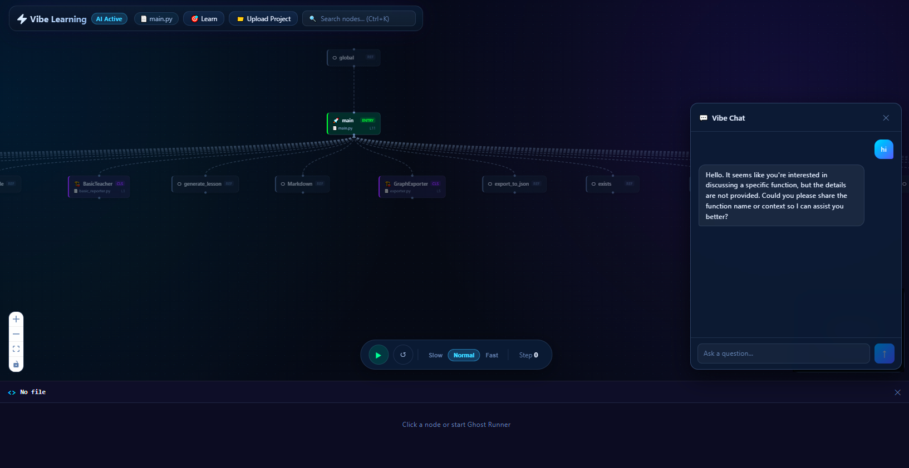
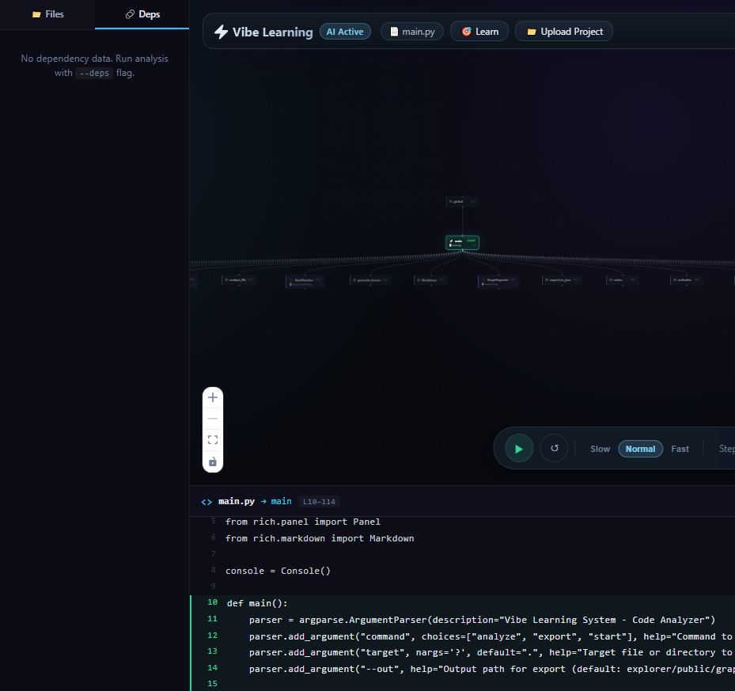

<div align="center">


# VibeGraph

**Turn a Python, JavaScript or TypeScript codebase into an interactive, AI-powered learning experience.**

Upload your code → explore the call graph → ask AI anything about it.

### ▶️ [Try it live → vibegraph.dev](https://vibegraph.dev) — no install needed


<sub>▶ <a href="docs/screenshots/vibegraph-demo.mp4">Watch the full-motion version</a> — smoother, with scene transitions</sub>

[](https://python.org)
[](https://developer.mozilla.org/en-US/docs/Web/JavaScript)
[](https://www.typescriptlang.org/)
[](https://react.dev)
[](https://fastapi.tiangolo.com)
[](https://openrouter.ai)
[](LICENSE)
[](https://github.com/madara88645/VibeGraph/actions/workflows/ci.yml)
[](https://fly.io)
[](https://vercel.com)

</div>

---

## What is VibeGraph?

VibeGraph parses your codebase with AST analysis, renders it as an interactive graph, and lets you click any function or class to get an AI explanation, ask follow-up questions, or watch a "Ghost Runner" animate the execution flow in real time.

Built for people who learn by exploring — vibe coders, junior devs, or anyone dropped into an unfamiliar repo.

### Supported languages

- **Python** (`.py`): parsed with Python's built-in `ast` module.
- **JavaScript** (`.js`, `.jsx`, `.mjs`, `.cjs`): parsed with tree-sitter. Functions, classes, ES module imports, `require()` and calls become graph nodes and edges.
- **TypeScript** (`.ts`, `.tsx`): parsed with tree-sitter using the same rules as JavaScript. Type-only imports are skipped; interfaces and type aliases are not shown as nodes.

---

## Screenshots

<table>
  <tr>
    <td align="center" width="50%">
      
      <sub><b>Interactive call graph</b> — file sidebar, node type filtering</sub>
    </td>
    <td align="center" width="50%">
      
      <sub><b>AI explanation panel</b> — click any node, get Technical or Analogy view</sub>
    </td>
  </tr>
  <tr>
    <td align="center" width="50%">
      
      <sub><b>AI chat</b> — multi-turn conversation about the selected node's code</sub>
    </td>
    <td align="center" width="50%">
      
      <sub><b>Dependency map</b> — imports and relationships per file</sub>
    </td>
  </tr>
</table>

---

## Features

| | Feature | Description |
|---|---------|-------------|
| 🧬 | **Interactive Call Graph** | Functions, classes, and relationships as a zoomable, pannable graph |
| 👻 | **Ghost Runner v2** | Intelligent code traversal with 5 strategies (Smart, Entry Flow, Hub Tour, By File, Random), AI narration, Explore mode, progress tracking, and run summaries |
| 🔍 | **Node Search** | Fuzzy search across all nodes with `Ctrl+K` — instantly zooms and highlights |
| 💬 | **AI Chat** | Multi-turn conversation about any node, with that node's source code and its callers/callees as context |
| 🎓 | **Learning Path** | Suggested study order for the whole project: start here, then go here. Built from the call graph and refined by AI when a key is available |
| 📝 | **Code Panel** | Source code with line numbers for every selected node |
| 💡 | **AI Explanations** | Beginner / Intermediate / Advanced levels, Technical or Analogy mode |
| 📤 | **Upload a Project** | Drop a project folder or a `.zip` containing Python, JavaScript or TypeScript files — the graph is built on upload |

### Ghost Runner v2

The Ghost Runner has been upgraded from a simple random walk to an intelligent, AI-powered code exploration tool:

- **5 Traversal Strategies** — **Smart** (DFS from entry points with hub pause), **Entry Flow** (follow real execution paths), **Hub Tour** (visit most-connected nodes first), **By File** (explore file by file), **Random** (classic mode)
- **AI Narration** — Each step gets a brief AI-generated explanation: what the function does and how it connects to the previous one
- **Explore Mode** — Switch from Auto to Explore to guide the ghost yourself — choose which connected node to visit next
- **Progress Tracking** — Live coverage bar showing nodes visited vs total, with visited-node highlighting
- **Run Summary** — On pause, see a summary: nodes/files covered, most connected hub, unvisited entry points

---

## Quick Start

### Prerequisites

- **Python 3.10+**
- **Node.js 20.19+ or 22.12+** (required by Vite 7; CI uses Node 20)
- **OpenRouter API key** from [openrouter.ai](https://openrouter.ai) — needed for the AI features

### 1. Clone

```bash
git clone https://github.com/madara88645/VibeGraph.git
cd VibeGraph
```

### 2. Install dependencies

```bash
# Python backend
pip install -r requirements.txt

# React frontend
cd explorer && npm install && cd ..
```

### 3. Configure (optional)

By default the app asks for an OpenRouter key in **AI Settings** in the browser, and the backend uses that key for each AI request.

To let the backend use its own key when no key is entered in AI Settings, create a `.env` file in the project root (see `.env.example`):

```env
OPENROUTER_API_KEY=your_openrouter_api_key_here
ALLOW_SERVER_FALLBACK_KEY=true
```

A key entered in AI Settings is still used first. Without `ALLOW_SERVER_FALLBACK_KEY=true`, the server key is ignored and a key entered in AI Settings is required.

### 4. Run

**Development mode** (hot reload on both sides):

```bash
# Terminal 1 — backend
python serve.py

# Terminal 2 — frontend
cd explorer && npm run dev
```

Open **[http://localhost:5173](http://localhost:5173)**

---

**Production mode** (single port, no Node needed after build):

```bash
cd explorer && npm run build && cd ..
python serve.py
```

Open **[http://localhost:8000](http://localhost:8000)**

---

### 5. Use it

**Upload your project** — click **Upload Project** in the top bar and choose a project folder or a `.zip` archive with Python, JavaScript or TypeScript files. The graph appears when analysis finishes.

**Analyze via CLI** (optional, for local files):

```bash
python main.py analyze path/to/your_project/
```

---

## Deployment

VibeGraph runs as a hybrid deployment:

| Component | Platform | URL |
|-----------|----------|-----|
| Backend API | [Fly.io](https://fly.io) | `vibegraph-api.fly.dev` |
| Frontend SPA | [Vercel](https://vercel.com) | `vibegraph.dev` (Vercel alias: `vibegraph.vercel.app`) |

### Docker Compose (local)

`docker-compose.yml` reads `.env`, so create one first (for example `cp .env.example .env`).

```bash
docker compose up
# Open http://localhost:8000
```

### Manual Deploy

**Backend (Fly.io):**
```bash
fly deploy --config fly.toml --dockerfile Dockerfile.fly
```

**Frontend (Vercel):**
Automatic deployment on push to `main` via Vercel integration.

---

## Project Structure

```
VibeGraph/
├── app/                   # FastAPI application
│   ├── routers/           # API route handlers (upload, explain, chat, ghost, learning)
│   ├── utils/             # Security, sanitization, snippet extraction
│   ├── models.py          # Pydantic request/response models
│   ├── dependencies.py    # AI provider config (OpenRouter)
│   └── rate_limit.py      # Rate limiting configuration
├── analyst/
│   ├── analyzer.py        # Python AST analysis + project walk → NetworkX graph
│   ├── languages/         # Language plugins: Python (ast), JavaScript/TypeScript (tree-sitter)
│   └── exporter.py        # NetworkX → React Flow JSON
├── teacher/
│   └── openrouter_teacher.py  # OpenRouter AI: explain / chat / ghost narration
├── explorer/              # React 19 + Vite frontend
│   └── src/components/    # GraphViewer, ChatDrawer, CodePanel, ProjectUpload, ...
├── tests/                 # pytest backend tests
├── .github/workflows/     # CI/CD (lint, security, tests, deploy)
├── fly.toml               # Fly.io deployment config
├── Dockerfile.fly         # Backend container
├── serve.py               # FastAPI server entry point
├── main.py                # CLI entry point
└── requirements.txt
```

---

## API

| Method | Endpoint | Description |
|--------|----------|-------------|
| `GET` | `/api/health` | Health check |
| `GET` | `/api/ai-config` | AI provider configuration discovery |
| `GET` | `/api/languages` | Languages and file extensions the analyzer supports |
| `POST` | `/api/upload-project` | Upload a project folder (as files) or a `.zip` of Python/JS/TS code, returns graph JSON |
| `POST` | `/api/snippet` | Extract source code for a node |
| `POST` | `/api/explain` | AI explanation for a node |
| `POST` | `/api/chat` | Multi-turn AI conversation |
| `POST` | `/api/chat/stream` | SSE streaming AI conversation |
| `POST` | `/api/learning-path` | Learning order built from the graph, refined by AI when a key is available |
| `POST` | `/api/ghost-narrate` | Ghost Runner AI narration |

---

## Tech Stack

| Layer | Technology |
|-------|-----------|
| Backend | Python 3.12, FastAPI, NetworkX |
| Parsing | Python: stdlib `ast` · JavaScript/TypeScript: tree-sitter |
| AI | OpenRouter models; the list is configured on the server and shown in AI Settings |
| Frontend | React 19, React Flow (graph rendering), dagre (layout), Vite 7 |
| Styling | Custom CSS — dark/light themes, glassmorphism |
| Testing | pytest (backend), Vitest (frontend) |
| Deploy | Fly.io (backend), Vercel (frontend) |
| Security | Rate limiting, path traversal protection, zip bomb prevention, prompt sanitization |

---

## Tests

```bash
# Backend
python -m pytest tests/ -v

# Frontend
cd explorer && npx vitest run
```

---

## Privacy & Data Handling

VibeGraph has no user accounts and no database. This is what happens to your code and your key:

- **Uploaded files are kept on the server after analysis** — The backend writes your files to a temporary folder (`vibegraph_upload_*` in the system temp directory) and keeps it, so the code panel, AI explanations, chat and Ghost Runner can read source snippets later. If an upload fails, the files written for it are deleted right away.
- **Old uploads are deleted after about an hour** — A background cleanup deletes upload folders older than one hour (`VIBEGRAPH_UPLOAD_RETENTION_SECONDS`, default `3600`). It runs when the server starts, then every 5 minutes (`VIBEGRAPH_UPLOAD_CLEANUP_INTERVAL_SECONDS`, default `300`), and after each successful upload. So while the server is running, an upload is deleted within about an hour plus that interval. If the server process is stopped (Fly.io stops idle machines), nothing runs while it is stopped; when the server starts again, the cleanup runs before it serves requests. There is no guaranteed minimum: if the files are gone, the code panel asks you to upload the project again.
- **Recently read files can stay in server memory** — To speed up snippet requests, the backend keeps a limited number of recently read source files in an in-memory cache. The cache is cleared when the server process restarts.
- **Uploads are not listed or shared** — Each upload gets a randomly named folder, and its path is returned only to the browser that uploaded it. No endpoint lists uploads.
- **What is sent to OpenRouter** — When you use an AI feature, the backend sends the relevant code snippet, related context (such as file paths, callers and callees) and, for chat, your messages to OpenRouter, which passes it to the model you selected. OpenRouter's and the model provider's own policies apply to that data.
- **Your OpenRouter key** — The key you enter in AI Settings is kept in your browser's `sessionStorage` (cleared when you close the tab) and sent as an `Authorization` header with each AI request to the VibeGraph backend (on vibegraph.dev, through Vercel's `/api` rewrite to Fly.io), which uses it to call OpenRouter. The backend does not save the key or write request headers to its logs.
- **What stays in your browser** — The graph, chat history, AI explanations, theme and model choice are saved in your browser's `localStorage`.

---

## License

Licensed under the [GNU Affero General Public License v3.0](LICENSE) (AGPL-3.0).
